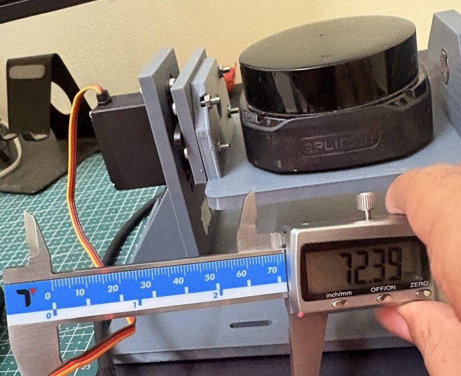
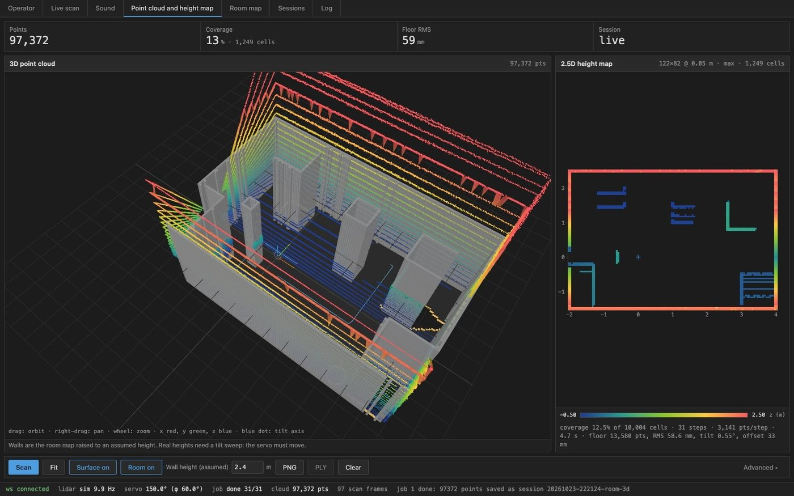
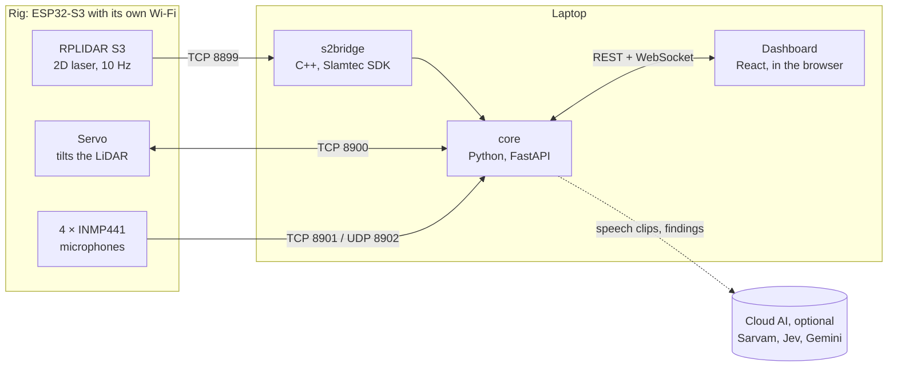
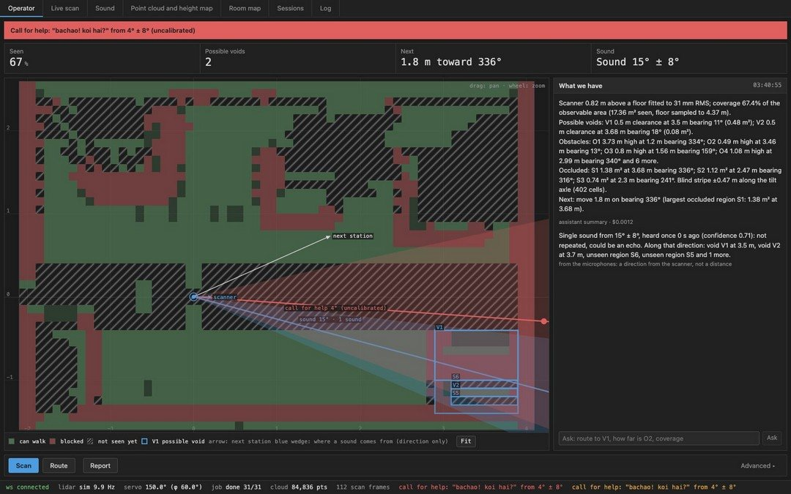
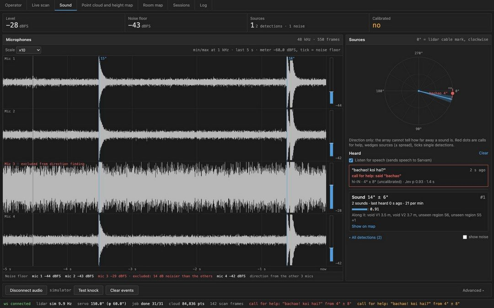
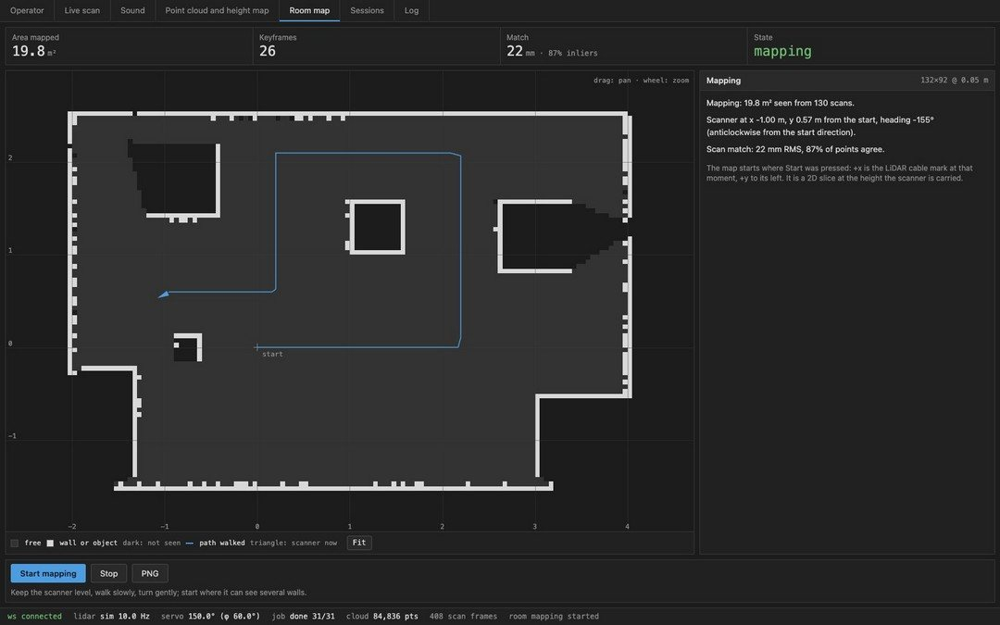
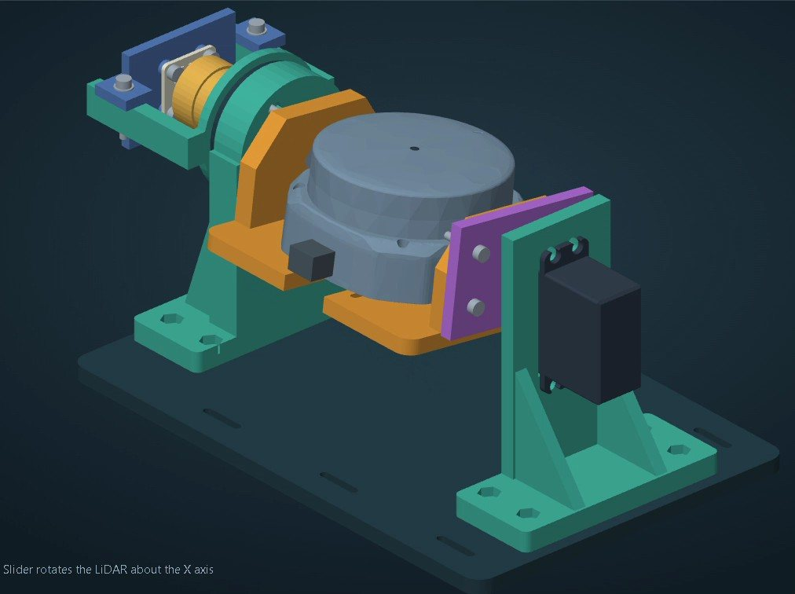

# obslam

**On-board SLAM for GPS-denied indoor search.**

obslam is a low-cost scanner for search and rescue indoors, where GPS does not work. A 2D LiDAR on a tilting cradle maps the room in 3D. Four microphones work out which direction knocks and voices come from, and spoken calls for help ("save me", "bachao") are flagged on the map. A laptop does the processing and shows everything on a browser dashboard.

<p align="center">
  
  
</p>

This is a final-year major project, now in Phase II. Phase I (the bench rig, software and dashboard) is complete; see [Progress](#progress).

## Contents

- [What it does](#what-it-does)
- [Try it without hardware](#try-it-without-hardware)
- [How it works](#how-it-works)
- [Screens](#screens)
- [Hardware](#hardware)
- [Project scope](#project-scope)
- [Progress](#progress)
- [Running it with the rig](#running-it-with-the-rig)
- [Documentation](#documentation)
- [Repository layout](#repository-layout)
- [Team](#team)
- [References](#references)

## What it does

- **Maps the room.** A servo tilts the LiDAR step by step. Each step adds one slice, and together they make a 3D point cloud and a 2.5D height map (the height of the tallest thing in each floor cell).
- **Reads the map for the operator.** It marks the floor as walkable or blocked and outlines obstacles and *possible voids*, which are gaps a person could fit into. It shows the parts the scanner could not see, suggests where to put the scanner next, and checks whether a route is passable.
- **Hears where sounds come from.** Four MEMS microphones time each sound to the microsecond and turn the differences into a direction. Repeated knocks from one direction are grouped into a single source and drawn as a wedge on the map.
- **Flags calls for help.** Only stretches of speech go out for transcription, never plain noise. A yes/no model then decides whether the words are a call for help, in English or Indian languages. A flagged call shows as a red dot with its direction.
- **Writes a short situation report.** It is written from the measured numbers. With no API keys, fixed templates take over and everything else keeps working.
- **Maps a whole floor plan.** Set the scanner down at several spots (six in the standard run). It joins the scans into one map and suggests the next spot.

The mapping and direction finding are plain maths (numpy). The AI services are only used for speech and wording, and each one is optional.

## Try it without hardware

The simulator runs a virtual room with rubble boxes, a tilting LiDAR and four microphones, so you can use the whole dashboard on a laptop.

You need macOS with [Xcode command line tools](https://developer.apple.com/xcode/resources/), [uv](https://docs.astral.sh/uv/) and [Bun](https://bun.sh). It was developed on Apple silicon Macs; Linux is untested.

```bash
git clone --recursive https://github.com/sxivansx/obslam.git
cd obslam
make setup     # builds the LiDAR driver, installs the Python and web dependencies
make sim       # starts the backend on :8000 and the dashboard on :5173
```

Open **http://localhost:5173** and press **Scan** on the Operator tab. A sweep takes about 15 seconds. When it finishes, the map fills in with walkable floor, obstacles and possible voids.

To try the AI parts, copy `core/.env.example` to `core/.env` and add any of the keys. [SETUP.md](SETUP.md#4-api-keys-coreenv) says what each key does.

## How it works



1. **Capture.** The ESP32-S3 on the rig starts its own Wi-Fi network (`SLAM-Test`). It passes the LiDAR's bytes through unchanged, drives the servo and streams the four microphones.
2. **Decode.** `s2bridge`, a small C++ program built on Slamtec's own SDK, turns the LiDAR bytes into one frame per rotation.
3. **Build the map.** The Python core combines each rotation with the tilt angle it was taken at. The result is a 3D point cloud, then a 2.5D height map. Sweeps are saved, so they can be replayed and exported later (PLY, CSV).
4. **Analyse.** The core fits the floor and classifies every cell (walkable, blocked, not seen). It finds obstacles and voids, works out where the scanner should go next, and plans routes with A\*.
5. **Listen.** GCC-PHAT gives the time difference between each pair of microphones, and that gives a direction. The array only gives a direction, never a distance, so a sound is drawn as a wedge, not a point.
6. **Hear speech.** Speech segments go to Sarvam (speech to text). Jev, a typed decision model, answers one question: is this a call for help?
7. **Show.** The dashboard gets live data over a WebSocket and shows it on seven screens.

The exact formats of every link are in [docs/api.md](docs/api.md).

## Screens

| Operator | Sound |
|---|---|
|  |  |
| The map for decisions: where you can walk, possible voids, the next scan spot, sound directions and calls for help. | Four microphone waveforms, sound directions on a compass, and what was heard. |
| **Point cloud and height map** | **Room map** |
|  |  |
| The raw 3D scan and its 2.5D height map. | A floor plan built from several scanner positions, with the next spot suggested. |

The other tabs are **Live scan** (the raw LiDAR view and the hardware controls), **Sessions** (saved sweeps, PLY/CSV export) and **Log**. [docs/dashboard-guide.pdf](docs/dashboard-guide.pdf) explains each part of each screen with numbered callouts.

## Hardware



| Part | What it does |
|---|---|
| RPLIDAR S3 | 2D laser scanner: 10 rotations a second, about 2,860 points each, up to 40 m |
| 13 kg·cm metal-gear servo on a 3D-printed cradle | tilts the LiDAR (about ±60°) to add height |
| AS5600 magnetic encoder (being fitted; the firmware already supports it) | will measure the real tilt angle on the axle |
| 4 × INMP441 MEMS microphones (I²S) | sound direction |
| MPU-6050 IMU | tilt and motion |
| ESP32-S3 N16R8 | relays the LiDAR, drives the servo, records the mics, runs the Wi-Fi network |
| 5 V power bank + separate 5–6 V, ≥ 3 A servo supply | power |

Apart from the LiDAR, the electronics cost about ₹5,000. Tilting a 2D LiDAR replaces a 3D LiDAR that would cost lakhs, and the ESP32-S3 replaces an onboard computer.

> [!WARNING]
> Power the ESP32 from the power bank only, and never from the laptop's USB and the power bank at the same time. The servo needs its own supply with its ground shared with the ESP32: on a shared power bank it stalls and resets the board.

Wiring, pins and flashing are in [firmware/README.md](firmware/README.md). For a first power-on of new hardware, follow [docs/bringup.md](docs/bringup.md).

<br clear="right">

## Project scope

**Problem.** Build and evaluate a low-cost system that maps GPS-denied indoor spaces and gives acoustic cues for finding survivors, while keeping to the compute, power and noise limits of a small payload.

**Objectives**

1. **Onboard indoor mapping** that works with limited sensing and compute.
2. **Spatial mapping:** extend flat scans to height maps, and study 3D and multi-robot methods.
3. **Acoustic event detection and bearing**, tested against background noise and later against drone rotor noise.
4. **Reproducible measurement** of map error, sensor accuracy and false alarms, so results do not rest on how the map looks.

**In scope**

- A tilting 2D LiDAR as a low-cost 3D scanner, used on a bench or carried by hand.
- 2.5D height maps, possible voids, unseen areas and routes, for one spot or for several spots joined into one map.
- The direction of knocks and voices from a four-microphone array, and spoken calls for help in English and Indian languages.
- An operator dashboard, saved sessions, and measured accuracy figures.

**Out of scope for now**

- **Flight.** The rig is on a bench or carried by hand. Moving the mapping onto an embedded board for a drone payload is the last Phase II step.
- **Sound distance.** The microphones are 2–4 cm apart, which is enough for a direction but not a range.
- **Detecting people directly.** There is no camera or thermal sensor. A "possible void" means a person could fit there, never that someone is there.
- **Full 3D SLAM and map sharing between robots.** These were covered in the literature review but are not built.

## Progress

### Phase I: bench rig and software (complete, October 2026)

| # | Checkpoint | What it delivered | Status |
|---|---|---|---|
| 1 | Contracts | One document ([docs/api.md](docs/api.md)) that fixes every link between the parts | Done, 22 Oct |
| 2 | LiDAR pipeline | C++ bridge over the Slamtec SDK, room simulator, 3D geometry, 2.5D height grid | Done, 22 Oct |
| 3 | Tilt scanning | ESP32 servo firmware, AS5600 encoder, step-and-scan sweeps, saved and replayable sessions | Done, 22 Oct |
| 4 | Dashboard | React + three.js dashboard, a mock backend, automated contract checks | Done, 22–23 Oct |
| 5 | Operator analysis | Floor, walkable or blocked, obstacles, voids, unseen areas, next spot, A\* routes, AI summary with template fallback | Done, 22 Oct |
| 6 | Wireless rig | ESP32-S3 relays the LiDAR and the tilt over its own Wi-Fi network | Done, 23–24 Oct |
| 7 | Hearing | 4-mic capture, GCC-PHAT direction, grouped sound sources, clap calibration, Sound tab | Done, 24 Oct |
| 8 | Calls for help | Speech segments, Sarvam transcription, Jev yes/no decision, red dot with a direction | Done, 24 Oct |
| 9 | Room map | 2D scan matching, a six-station sprint, next-spot guidance | Done, 24 Oct |
| 10 | Phase I review | [Presentation](docs/presentation/) and [dashboard guide](docs/dashboard-guide.pdf) | Done, 24 Oct |

**Measured at the end of Phase I**

| | |
|---|---|
| LiDAR | 10 Hz, about 2,860 points per rotation |
| Range noise | 0.9 mm under 1 m, 4.8 mm at 2–4 m |
| Call for help | flagged about 2 s after it is spoken |
| Room map drift | under 1 cm |
| Tests | 126 automated tests, all runnable on the simulator |
| Stability | 10-minute soak: 38 sweeps, 0 failures, analysis under 0.4 s per sweep ([report](docs/soak-2026-10-22.md)) |

**Open issues**

- The servo stalls when it shares the power bank. It needs its own 6 V / 3 A supply.
- One microphone picks up servo noise. The software drops a noisy mic automatically, but the cause is still there.

### Phase II: from bench rig to field test (November 2026 – April 2027)

| # | When | Checkpoint | Goal | Status |
|---|---|---|---|---|
| 1 | Nov 2026 | Servo power fix | Its own 6 V / 3 A supply; confirm the tilt with the IMU | Next |
| 2 | Dec 2026 | 2.5D at every station | A tilt sweep at each of the six spots, merged into one room model | Planned |
| 3 | Jan 2027 | Microphone calibration | A clap test fixes channel order, yaw and timing; target bearing error 5° or less | Planned |
| 4 | Feb 2027 | Mock-rubble field test | A debris room with hidden knocks and voices; measure map error and detection rate | Planned |
| 5 | Mar–Apr 2027 | Onboard SLAM | Move the mapping onto the embedded board, toward a drone payload | Planned |

**Phase II goal:** a 2.5D room model with marked voids and call-for-help directions, checked against measurements of the real room.

## Running it with the rig

1. Power the rig from its power bank and wait about 10 seconds.
2. Join the Wi-Fi network **`SLAM-Test`** (password `SLAMtest24`). The rig is at `192.168.4.1`.
3. Run `make dev` and open http://localhost:5173.
4. Connect the hardware from the **Live scan** and **Sound** tabs: LiDAR `tcp://192.168.4.1:8899`, servo `tcp://192.168.4.1:8900`, microphones `tcp://192.168.4.1:8901`.

To reach the internet as well (needed for the AI parts), use a wired connection or iPhone USB tethering. [SETUP.md](SETUP.md) walks through a fresh Mac step by step, including terminal commands and a troubleshooting table.

## Documentation

Start at the top and stop when you have what you need.

| Document | Read it when you want to |
|---|---|
| [SETUP.md](SETUP.md) | set up a Mac, connect to the rig and run everything |
| [docs/dashboard-guide.pdf](docs/dashboard-guide.pdf) | understand what each part of each screen means |
| [docs/bringup.md](docs/bringup.md) | wire up and calibrate new hardware for the first time |
| [firmware/README.md](firmware/README.md) | wire, flash or send commands to the ESP32 |
| [docs/api.md](docs/api.md) | see the exact formats between the rig, the backend and the dashboard |
| [core/README.md](core/README.md) | work on the Python backend |
| [web/README.md](web/README.md) | work on the dashboard |
| [driver/README.md](driver/README.md) | work on the LiDAR bridge |
| [docs/presentation/](docs/presentation/) | see the Phase I review (PDF and PPTX) |

## Repository layout

```
driver/     C++ LiDAR bridge over Slamtec's rplidar_sdk (git submodule)
core/       Python 3.12 backend: FastAPI server, mapping, acoustics, speech, AI layer, tests
web/        React + react-three-fiber dashboard, built with Bun and Vite
firmware/   ESP32-S3 Arduino sketch: LiDAR relay, tilt servo, microphones, Wi-Fi
docs/       contracts, bring-up runbook, dashboard guide, presentation, images
Makefile    setup, dev, sim, test, build, serve, flash
```

| Command | What it does |
|---|---|
| `make setup` | build the driver and install the Python and web dependencies |
| `make dev` | backend on :8000 and dashboard on :5173 (real hardware) |
| `make sim` | the same with the simulator |
| `make test` | Python tests and the web type check |
| `make build && make serve` | one process on :8000 serving the built dashboard |
| `make flash PORT=… FQBN=esp32:esp32:esp32s3:PSRAM=opi` | flash the ESP32-S3 |

## Team

Major project (22ETP76, 2026–27), Department of Electronics and Telecommunication Engineering, Dayananda Sagar College of Engineering, Bengaluru.

- Naman Singh
- Shivansh Kumar Pandey
- Sai Shourya Inguru
- Shraddha Upadhyay

Guide: Jayanth C, Assistant Professor. Co-guide: Dr. Smitha Sasi, Associate Professor.

## References

Selected from the 26-paper literature review in the Phase I presentation.

1. Steux and El Hamzaoui (2010). *tinySLAM: a SLAM algorithm in less than 200 lines of C.* ICARCV, 1975–1979.
2. Markdahl and Vikgren (2023). *tinySLAM-based exploration with a swarm of nano-UAVs.* SWARM 2023, arXiv:2309.02834.
3. Niculescu et al. (2024). *Ultra-lightweight collaborative mapping for robot swarms.* arXiv:2407.03136.
4. Tranzatto et al. (2022). *CERBERUS in the DARPA Subterranean Challenge.* Science Robotics 7, eabp9742.
5. Lajoie and Beltrame (2024). *Swarm-SLAM: sparse decentralized collaborative SLAM framework.* IEEE RA-L 9(1), 475–482.
6. Sun et al. (2025). *Acoustic event detection for drone search and rescue using rotor-noise beamforming.* Digital Signal Processing 157, 104881.
